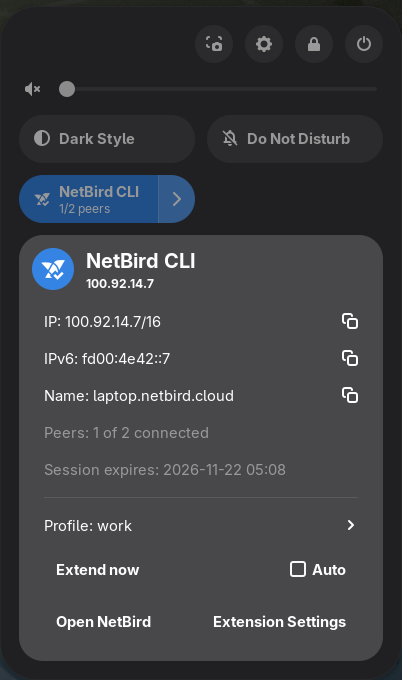

# NetBird GNOME Shell extension

Quick Settings toggle to connect/disconnect [NetBird](https://netbird.io),
driven by the `netbird` CLI.



## Features

- **Toggle** runs `netbird up` / `netbird down`; subtitle shows connected peers
- **Menu**: IP, FQDN, peers, session expiry, Refresh
- **Profile switcher**: lists `netbird profile list`; selecting one runs
  `netbird profile select` and reconnects if you were connected
- **Session expiry warning**: notification N minutes before the SSO session
  expires, with an *Extend session* action (`netbird login --extend`)
- **Panel icon** while connected (optional)
- **Preferences**: poll interval, panel icon, expiry warning, CLI path

`netbird up` / `login --extend` open the browser themselves when SSO is
needed. Click the toggle again while "Connecting…" to abort.

## Requirements

- GNOME Shell 46–50
- `netbird` CLI, daemon running, and `/var/run/netbird.sock` accessible by
  your user

## Development

```sh
make install     # compile schemas, symlink into ~/.local/share/gnome-shell/extensions
make test        # parser unit tests (gjs)
make nested      # try it in a nested shell window (Wayland, in-memory settings)
make enable      # enable in your session (log out/in first on Wayland)
make prefs       # open preferences
make logs        # follow gnome-shell logs
make pack        # build dist/*.zip for extensions.gnome.org
make rpm         # build dist/*.rpm (noarch + src) from the current tree
make screenshot  # regenerate screenshots/quick-settings.png (headless, demo data)
```
