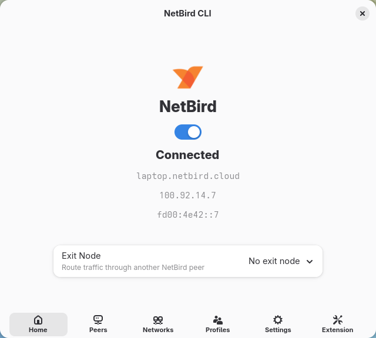
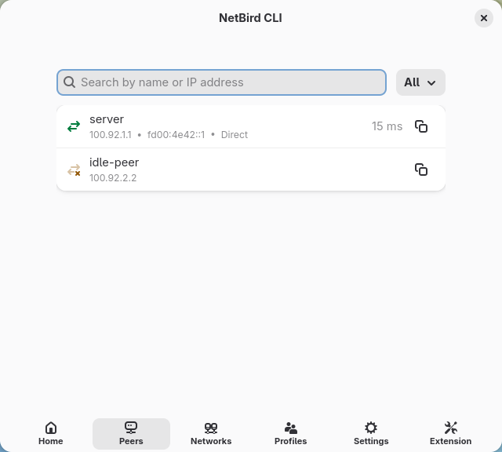

# NetBird CLI GNOME Shell extension

Quick Settings toggle to connect/disconnect [NetBird](https://netbird.io),
driven by the `netbird` CLI.


## Features

Quick Settings:

- **Toggle** runs `netbird up` / `netbird down`; subtitle shows connected
  peers. Click again while "Connecting…" to abort.
- **Menu**: IP (click *Copy IP Address*), IPv6, FQDN, peers, session expiry,
  profile switcher, *Extend session*, *Open NetBird*, Refresh
- **Session expiry**: warning N minutes before the SSO session expires, with
  an *Extend session* action (`netbird login --extend`); a notice with a
  *Sign In* action when the session has expired
- **Auto-extend** (optional): renews the session at the warning lead time.
  It opens your browser; no input is needed if you are still signed in to
  your identity provider.
- **GNOME VPN guard** (optional, on by default): while NetBird is connected,
  GNOME's VPN button is disabled and NetBird's `wt0` is hidden from it;
  other VPNs are disconnected before connecting
- **Panel icon** while connected (optional), NetBird state icons

NetBird window (*Open NetBird*, or the extension's preferences):

- **Home**: connect switch, state, FQDN / IPv4 / IPv6 (click to copy),
  exit-node selector
- **Peers**: search by name or IP, filter by state, latency, traffic and
  last handshake, copy a peer's IP
- **Networks**: select / deselect network resources
- **Profiles**: switch, add, rename, sign out, remove
- **Settings**: NetBird daemon settings (DNS, routes, WireGuard, SSH,
  quantum resistance…); fields managed by your organization are read-only;
  *Create Debug Bundle* (optionally anonymized and uploaded)
- **Extension**: poll interval, panel icon, expiry warning, auto-extend,
  VPN guard, CLI path

| Home | Peers |
|---|---|
|  |  |

## How it differs from the official extension

The official [NetBird for GNOME](https://github.com/netbirdio/gnome-extension)
extension talks to the daemon's HTTP/JSON socket, which is disabled by
default (`netbird service reconfigure --enable-json-socket`). This one only
runs the `netbird` CLI, so it works with a stock daemon, as your user,
without reconfiguring the service. Trade-offs:

- Status is polled (every 2 s while the menu or window is open, otherwise
  every *poll interval*), not streamed.
- The CLI writes settings only through `netbird up`, so saving a setting
  connects NetBird; if it was disconnected it is disconnected again.
- No *Check for update* (no CLI equivalent).
- Some settings (e.g. the SSH server) are refused by the daemon for
  non-root users, as with the official extension.

## Requirements

- GNOME Shell 46–51 (Fedora 40–45)
- `netbird` CLI, daemon running, and `/var/run/netbird.sock` accessible by
  your user

## Development

```sh
make install     # compile schemas, symlink into ~/.local/share/gnome-shell/extensions
make test        # unit tests (gjs)
make nested      # try it in a nested shell window (Wayland, in-memory settings;
                 # uses the host NetworkManager: the VPN guard acts on real VPNs)
make enable      # enable in your session (log out/in first on Wayland)
make prefs       # open preferences
make logs        # follow gnome-shell logs
make pack        # build dist/*.zip for extensions.gnome.org
make rpm         # build dist/*.rpm (noarch + src) from the current tree
make screenshot  # regenerate screenshots/quick-settings.png (headless, demo data)
make smoke       # nested headless Wayland shell, mock CLI, fails on JS errors
```
